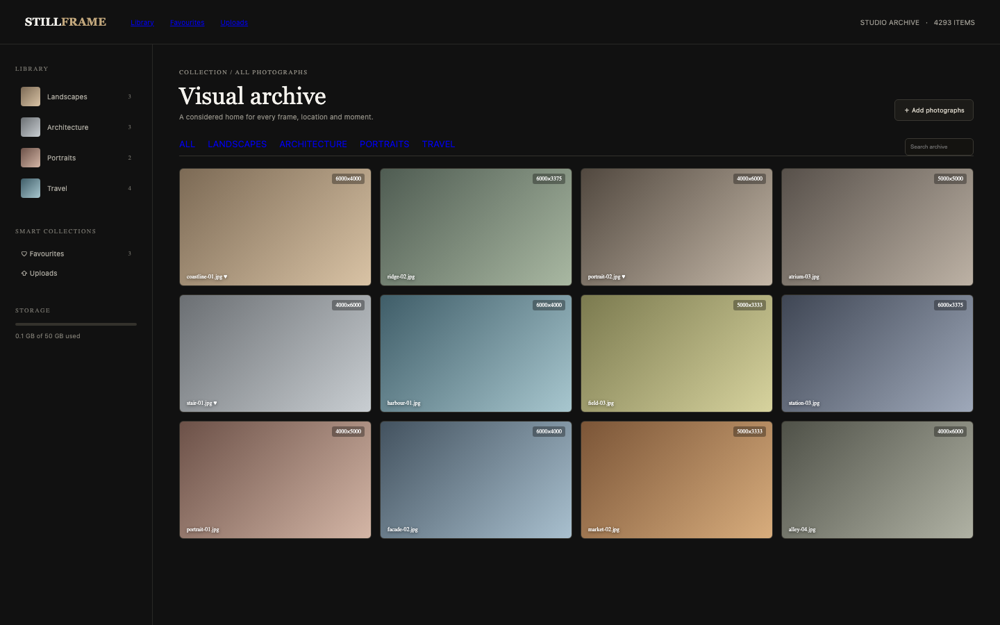

# Photo Gallery

An editorial archive: albums, a masonry grid, favourites, an offline lightbox and an upload form. The previews are gradients, so it works without a network.

## Run it

```sh
npm install
npm start
```

Open the address it prints. `npm test` runs the tests (node:test; no network, no key).

## What to ask the chat next

- Add a photograph to the Travel album with a blue preview.
- Favourite a portrait and open the Favourites collection.
- Open a photo and step to the next frame in its album.

## Screenshot


